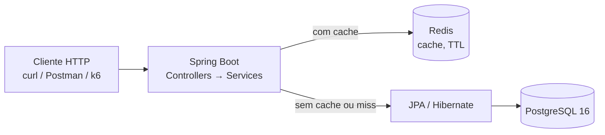
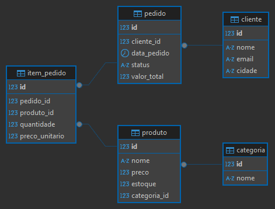
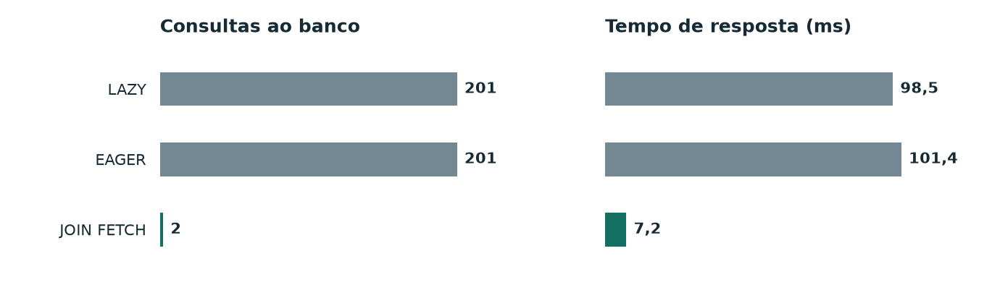
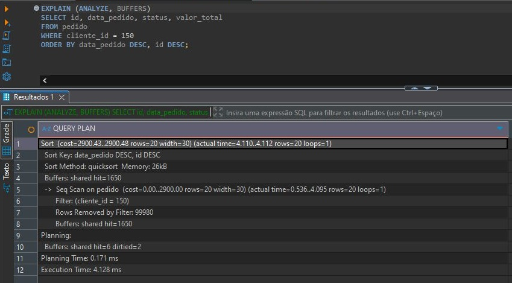
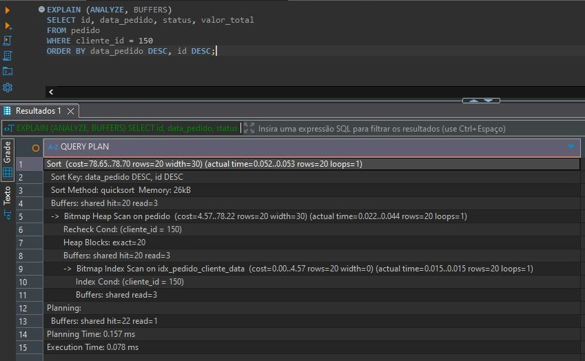
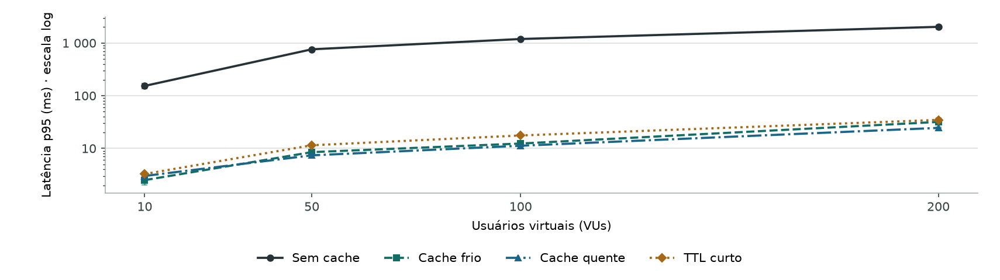
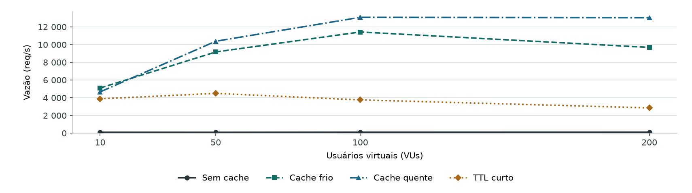
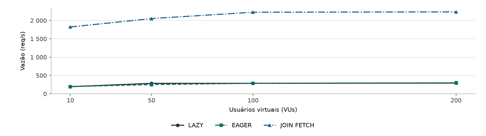
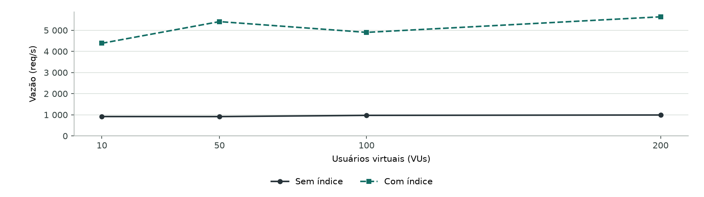

# A2 — Otimização de Web Services: Cache, Consultas ao Banco e Testes de Desempenho

Análise e Otimização de Sistemas · Universidade Veiga de Almeida · Professor André Lucio

**Escopo.** Cache, otimização de consultas e índices, e testes de desempenho.

## Sumário

1. [Introdução](#1-introdução)
2. [Arquitetura e tecnologias](#2-arquitetura-e-tecnologias)
3. [Implementação de cache](#3-implementação-de-cache)
4. [Otimização das consultas](#4-otimização-das-consultas)
5. [Testes de desempenho](#5-testes-de-desempenho)
6. [Discussão](#6-discussão)
7. [Conclusão](#7-conclusão)
8. [Anexo — Como executar e reproduzir](#8-anexo--como-executar-e-reproduzir)

Para executar o projeto, comece pelo [Anexo](#8-anexo--como-executar-e-reproduzir). Para conferir as medições, vá aos [resultados do k6](#53-resultados).

## 1. Introdução

A aplicação é um **Web Service REST de e-commerce simplificado**, sem interface gráfica. Permite consultar e atualizar produtos, calcular estatísticas por categoria e listar pedidos.

| Item | Técnica | Pergunta investigada |
|---|---|---|
| 1 | Cache (Redis) | Quanto o armazenamento temporário reduz acessos ao banco e a latência? Qual o risco de dados velhos? |
| 2 | Estratégias de carregamento (LAZY, EAGER, JOIN FETCH, DTO, SQL nativo) e índices | Quantas consultas o ORM dispara? Como o problema N+1 aparece? Como um índice muda o plano de execução? |
| 3 | Testes de carga (k6) | Os ganhos se mantêm com 10, 50, 100 e 200 usuários simultâneos? |

**Objetivos.** Implementar versões comparáveis das operações, medir consultas SQL, planos de execução, latência, vazão e erros, e discutir os ganhos, custos e limitações.

**Volume de dados.** A carga inicial é automática. A tabela mostra as contagens registradas na bateria de testes.

| Tabela | Registros |
|---|---|
| categoria | 20 |
| cliente | 5.000 |
| produto | 10.000 |
| **pedido** (entidade principal) | **100.000** |
| item_pedido | 300.000 (1 a 5 por pedido) |

[Configuração e contagens da bateria](evidencias/execucao.json)

## 2. Arquitetura e tecnologias

Leia o diagrama da esquerda para a direita. O cliente chama a API. Nos endpoints com cache, ela procura a resposta primeiro no Redis (se houver **hit**, devolve direto; se houver **miss**, consulta o PostgreSQL pelo Hibernate e salva o retorno no Redis). Nos endpoints sem cache ou de pedidos, a chamada vai direto para o Hibernate e o PostgreSQL.



| Camada | Tecnologia | Papel |
|---|---|---|
| Linguagem / framework | Java 17, Spring Boot 3.3 (Spring Web) | API REST |
| Persistência | Spring Data JPA + Hibernate 6 | ORM; comparação LAZY × EAGER |
| Banco relacional | PostgreSQL 16 (Docker) | Dados e `EXPLAIN ANALYZE` |
| Cache | Redis 7 (Docker) | Cache-aside com TTL |
| Carga | Grafana k6 | Cenários, VUs, p95/p99 |
| Ambiente local | Docker Compose | Sobe PostgreSQL e Redis |

O Maven Wrapper compila a API. O DBeaver foi usado para inspecionar o modelo e os planos do banco. Os scripts Python automatizam as medições e geram os gráficos.

### 2.1 Modelo de dados

```text
categoria 1───N produto 1───N item_pedido N───1 pedido N───1 cliente
```

| Entidade | Principais campos | Observação |
|---|---|---|
| `Categoria` | id, nome | agrupa produtos |
| `Produto` | id, nome, preco, estoque, categoria (LAZY) | alvo do cache e do `PUT` |
| `Cliente` | id, nome, email, cidade | vinculado a pedidos |
| `Pedido` | id, cliente, dataPedido, status, valorTotal | mapeado **duas vezes** (ver abaixo) |
| `ItemPedido` | id, produtoId, quantidade, precoUnitario | registra o produto e as condições da compra |



Para comparar LAZY × EAGER **sobre os mesmos dados**, a tabela `pedido` é mapeada por duas entidades que herdam de
`PedidoBase`: `PedidoLazy` (`FetchType.LAZY` em cliente e itens) e `PedidoEager` (`FetchType.EAGER`).

[Esquema SQL](src/main/resources/schema.sql) · [Carga inicial](src/main/java/br/edu/uva/otimizacao/config/DataSeeder.java)

### 2.2 Endpoints

#### Catálogo e cache

| Método e rota | Finalidade |
| --- | --- |
| `GET /api/produtos/{id}/sem-cache` | Consultar o produto diretamente no banco |
| `GET /api/produtos/{id}/com-cache` | Consultar o produto com cache. Aceita `?ttl=N` em segundos |
| `PUT /api/produtos/{id}` | Atualizar nome, preço ou estoque e invalidar o cache por padrão. Aceita `?invalidarCache=false` para o teste de expiração |
| `GET /api/categorias/{id}/estatisticas/sem-cache` | Calcular as estatísticas direto no banco |
| `GET /api/categorias/{id}/estatisticas/com-cache` | Consultar as estatísticas com cache. Também aceita `?ttl=N` |

#### Pedidos e persistência

| Método e rota | Finalidade |
| --- | --- |
| `GET /api/pedidos/lazy?limit=N` | Listar com carregamento sob demanda |
| `GET /api/pedidos/eager?limit=N` | Listar com carregamento antecipado |
| `GET /api/pedidos/join-fetch?limit=N` | Listar com a consulta otimizada |
| `GET /api/pedidos/dto?limit=N` | Retornar um resumo por projeção JPQL |
| `GET /api/pedidos/dto-nativo?limit=N` | Retornar o mesmo resumo por SQL nativo |
| `GET /api/pedidos/cliente/{id}` | Buscar pedidos de um cliente |
| `GET /api/pedidos/cliente/{id}/explain` | Executar `EXPLAIN (ANALYZE, BUFFERS)` da mesma busca |

`lazy` e `eager` aceitam `&incluirItens=false` para comparar o custo de omitir os itens da resposta.

#### Apoio aos experimentos

| Método e rota | Finalidade |
| --- | --- |
| `POST /api/admin/cache/limpar` | Limpar as chaves da aplicação e zerar os contadores |
| `GET /api/admin/cache/estatisticas` | Consultar hits, misses e chaves no Redis |
| `POST /api/admin/indice` | Criar o índice do experimento e informar seu tamanho |
| `DELETE /api/admin/indice` | Remover o índice do experimento |
| `GET /api/admin/contagens` | Conferir o número de registros por tabela |
| `GET /api/admin/ambiente` | Registrar versões e o tamanho do pool do banco |

### 2.3 Observabilidade das consultas

Nas rotas de cache e na comparação de LAZY, EAGER e JOIN FETCH, o JSON informa `consultasSql` e `tempoServicoMs`. O primeiro campo conta os comandos registrados pelo `StatementInspector` do Hibernate na thread da requisição. O segundo mede o tempo no serviço, em milissegundos.

- **Cache.** `X-Cache` identifica `BYPASS` (ida direta ao banco), `MISS` ou `HIT`. O corpo também mostra a origem e o TTL restante.
- **Pedidos.** `itensHidratados` indica quantos itens o Hibernate carregou, inclusive os que ficaram fora do JSON.
- **Console.** No perfil `dev`, `spring.jpa.show-sql` exibe o SQL e `hibernate.generate_statistics` habilita as estatísticas do Hibernate. O console mostra a contagem de comandos JDBC ao final de cada sessão. Na bateria usamos `perf` para desativar esses logs.

## 3. Implementação de cache

### 3.1 O que foi cacheado e por quê

| Operação | Frequência esperada | Volatilidade | Custo no banco | Risco de dado desatualizado | Decisão |
|---|---|---|---|---|---|
| Produto por ID | Consultas repetidas no catálogo | Preço e estoque mudam | Baixo. Busca pela chave primária | Exibir preço ou estoque antigo | Cache com **TTL de 60 s** e invalidação no `PUT` |
| Estatísticas da categoria | Consultas repetidas à mesma categoria | Muda com produtos e vendas | Alto. Agrega dados do catálogo e dos pedidos | Exibir um resumo com alguns minutos de atraso | Cache com **TTL de 300 s** e invalidação no `PUT` de produto |
| Pedidos (LAZY, EAGER e índice) | Depende do cliente e da listagem | A lista muda com novos pedidos | Varia conforme a consulta | Omitir pedidos recentes | Consultar direto no PostgreSQL para medir cada estratégia |

As estatísticas de unidades vendidas e receita consideram pedidos pagos, enviados ou entregues. Os dois alvos do cache permitem comparar uma busca barata por chave primária com uma agregação mais cara.

### 3.2 Estratégia: cache-aside com Redis

1. Em uma rota **com cache**, a aplicação procura a chave no Redis.
2. Se a resposta existe (**hit**), devolve o JSON sem consultar o PostgreSQL.
3. Se a resposta está ausente ou expirada (**miss**), lê o banco e grava o JSON com TTL.

Escolhemos o Redis porque mantém o cache fora da JVM e permite definir a expiração de cada chave. As respostas ficam em JSON nas chaves `a2:produto:{id}` e `a2:categoria-stats:{id}`. Nas rotas **sem cache**, a leitura vai direto ao PostgreSQL.

### 3.3 TTL e invalidação

| Mecanismo | Configuração | Efeito |
|---|---|---|
| **TTL (expiração)** | `app.cache.ttl-produto-segundos=60`, `app.cache.ttl-categoria-segundos=300` | Limita o tempo de vida de cada chave |
| **Invalidação ativa** | `PUT /api/produtos/{id}` | Remove o produto do cache e as estatísticas da categoria |
| **Modo sem invalidação** | `PUT /api/produtos/{id}?invalidarCache=false` | Permite observar o valor anterior até a chave expirar |

O parâmetro `?ttl=N` ajusta o TTL ao gravar uma chave, entre 1 e 3.600 segundos. Se a chave já existe, ela conserva o TTL recebido na gravação.

A invalidação ocorre antes de concluir a transação. O bloqueio na instância da API impede que uma leitura com cache grave o valor antigo durante a atualização. Se o Redis falhar durante a invalidação, a transação é revertida.

### 3.4 Experimento de cache

Usamos o produto 10 para comparar o acesso direto ao banco, o reaproveitamento do cache, a invalidação após uma atualização e a expiração. O experimento automatizado usou TTL de **2 s** para observar a expiração. As requisições estão no [roteiro de reprodução](#82-reproduzir-o-experimento-de-cache).

**Atualização com invalidação**

Consultamos o produto 10 por `GET /api/produtos/10/sem-cache` e `GET /api/produtos/10/com-cache`. Depois, enviamos `{"preco":125.50}` para `PUT /api/produtos/10` e consultamos o produto novamente.

| Leitura do produto 10 | Estado do cache | Consultas SQL | Preço |
| --- | --- | ---: | ---: |
| Direto do banco | BYPASS | 1 | R$ 8,70 |
| Primeira leitura com cache | MISS | 1 | R$ 8,70 |
| Repetição | HIT | 0 | R$ 8,70 |
| Primeira leitura depois do PUT | MISS | 1 | R$ 125,50 |
| Repetição depois do PUT | HIT | 0 | R$ 125,50 |

**Expiração sem invalidação**

Na primeira leitura depois do PUT, usamos `?ttl=2` para preencher o cache por dois segundos. Com a chave ainda válida, fizemos outro PUT com `?invalidarCache=false` e alteramos o preço para **R$ 140,50**.

| Leitura do produto 10 | Estado do cache | Consultas SQL | Preço |
| --- | --- | ---: | ---: |
| Com cache, logo depois do segundo PUT | HIT | 0 | R$ 125,50 |
| Direto do banco, logo depois do segundo PUT | BYPASS | 1 | R$ 140,50 |
| Com cache, depois que a chave expirou | MISS | 1 | R$ 140,50 |

O teste restaura o preço inicial ao concluir. Para repetir a medição, siga o [roteiro de reprodução](#85-reproduzir-as-medições-do-relatório). [Registro do teste](evidencias/consultas/cache-roteiro.csv)

### 3.5 Análise de desempenho do cache

| Consulta | Sem cache | Primeiro acesso (MISS) | Repetição (HIT) |
| --- | ---: | ---: | ---: |
| Produto | 4,04 ms | 6,87 ms | 4,00 ms |
| Estatísticas da categoria | 40,39 ms | 39,21 ms | **3,25 ms** |

São medianas de 15 leituras por condição, medidas no cliente. Houve **1 consulta SQL** no acesso direto e no miss, e **0 consultas** no hit.

**1. Em quais situações o cache apresentou maior benefício?**

O cache trouxe o maior ganho nas **estatísticas de categoria**, justamente onde a consulta ao banco é mais pesada (uma agregação que cruza produtos, pedidos e 300 mil itens). Ao evitar recalcular esses totais a cada requisição, o tempo mediano no cliente caiu de **40,39 ms para 3,25 ms** no hit, um benefício que se ampliou ainda mais sob carga no [cenário de cache](#cenário-1--cache-da-categoria).

**2. Como a volatilidade dos dados influenciou a escolha do TTL?**

Quanto maior a chance de um dado mudar com frequência, menor precisa ser o seu tempo de vida no cache. Como preço e estoque de um produto podem ser alterados a qualquer momento, definimos um TTL mais curto de **60 s** junto com invalidação imediata no `PUT`. Já as estatísticas agregadas por categoria toleram alguns minutos de defasagem sem prejudicar o usuário, o que permitiu adotar um TTL maior de **300 s** (também invalidado sempre que um produto daquela categoria é atualizado).

**3. Quais são os riscos de utilizar informações desatualizadas?**

Servir dados antigos pelo cache faz o sistema mostrar uma realidade que já não existe no banco. Em um e-commerce, isso pode significar exibir um preço já alterado, mostrar estoque disponível para um produto esgotado ou gerar divergência entre telas diferentes da mesma aplicação. No teste sem invalidação, vimos esse efeito na prática: o banco já tinha o preço novo (**R$ 140,50**), mas o cache continuou devolvendo o preço antigo (**R$ 125,50**) até o TTL vencer.

**4. O cache sempre melhorou o desempenho?**

**Não.** Quando a consulta original já é muito rápida, como buscar um produto diretamente pela chave primária, o cache pode até piorar o tempo em caso de miss. No teste de produto, o miss levou **6,87 ms**, contra **4,04 ms** indo direto ao banco, porque a aplicação precisou consultar o Redis, buscar no PostgreSQL e gravar a resposta no Redis. Mesmo no hit (**4,00 ms**), a diferença foi pequena nesse caso. Isso mostra que o cache vale mais a pena quando o custo da consulta ao banco é alto ou quando o volume de acessos concorrentes sobrecarrega o SGBD ([medições de cache](evidencias/consultas/cache-tempos.csv)).

## 4. Otimização das consultas

### 4.1 LAZY e o problema N+1

`PedidoLazy` deixa o carregamento dos relacionamentos para quando eles forem usados. O código configura cliente e itens com `FetchType.LAZY`.

```java
@ManyToOne(fetch = FetchType.LAZY)
@JoinColumn(name = "cliente_id")
private Cliente cliente;

@OneToMany(fetch = FetchType.LAZY)
@JoinColumn(name = "pedido_id", insertable = false, updatable = false)
@OrderBy("id ASC")
private List<ItemPedido> itens = new ArrayList<>();
```

Ao montar a resposta, o serviço lê o nome do cliente e percorre os itens de cada pedido. Com LAZY, esses acessos dispararam consultas adicionais. O SQL abaixo, abreviado a partir do log de uma chamada com `limit=3`, mostra a repetição.

```sql
SELECT ... FROM pedido ORDER BY id FETCH FIRST ? ROWS ONLY;  -- 1× para a página
SELECT ... FROM item_pedido WHERE pedido_id = ? ORDER BY id; -- 3×, uma por pedido
SELECT ... FROM cliente WHERE id = ?;                       -- 3×, uma por cliente distinto
```

Ao listar **100 pedidos de 100 clientes distintos**, o mesmo padrão gerou **201 consultas** (1 da página + 100 de itens + 100 de clientes). Esse é o problema N+1. [SQL gerado pelo Hibernate](evidencias/consultas/sql-hibernate.txt)

### 4.2 EAGER — o que realmente acontece

`PedidoEager` carrega cliente e itens de forma antecipada. Na consulta JPQL usada na listagem, o Hibernate também executou buscas adicionais. Ao pedir 100 pedidos com `incluirItens=false`, a resposta foi a mesma para LAZY e EAGER, mas a quantidade de trabalho no banco mudou.

| Estratégia sem itens na resposta | Consultas SQL | Itens carregados pelo Hibernate |
| --- | ---: | ---: |
| LAZY | 101 | 0 |
| EAGER | 201 | 300 |

### 4.3 Comparação das estratégias

#### Consultas SQL por requisição

Fizemos uma requisição por vez e repetimos cada estratégia cinco vezes por tamanho de lista.

| Pedidos | LAZY | EAGER | JOIN FETCH |
| ---: | ---: | ---: | ---: |
| 10 | 21 | 21 | **2** |
| 100 | 201 | 201 | **2** |
| 500 | 1.001 | 1.001 | **2** |

O JOIN FETCH manteve duas consultas nos três tamanhos.

#### Tempo de resposta e volume de dados

Os tempos são as medianas medidas no cliente. Para cada tamanho de lista, as três rotas devolveram os mesmos pedidos, itens e tamanho do campo `dados` no JSON.

| Pedidos | Itens retornados | Campo `dados` (JSON) | LAZY | EAGER | JOIN FETCH |
| ---: | ---: | ---: | ---: | ---: | ---: |
| 10 | 30 | 2,9 KiB | 16,96 ms | 15,75 ms | **6,30 ms** |
| 100 | 300 | 29,5 KiB | 98,53 ms | 101,44 ms | **7,21 ms** |
| 500 | 1.500 | 147,9 KiB | 473,91 ms | 499,04 ms | **22,43 ms** |

Quando os itens são omitidos (`incluirItens=false`), o campo `dados` para 100 pedidos cai de **29,5 KiB para 13,2 KiB**, e na projeção DTO cai para **11,9 KiB**, mas no EAGER o Hibernate continuou carregando todos os 300 itens da base antes de descartá-los na serialização.



[Medições por tamanho da lista](evidencias/consultas/persistencia.csv)

**Quando usar cada estratégia?**

- **LAZY** é a escolha mais segura como padrão no mapeamento das entidades, porque evita puxar dados relacionados que nem todas as telas ou endpoints usam. O cuidado necessário é não percorrer associações lazy dentro de um laço sem planejamento, pois isso dispara o problema N+1.
- **EAGER** faz sentido apenas em relacionamentos pequenos que são *sempre* necessários junto com a entidade principal. No nosso experimento com listagem JPQL, ele não evitou o N+1 e ainda desperdiçou trabalho carregando 300 itens mesmo quando o endpoint não os incluía na resposta.
- **JOIN FETCH e projeções DTO** são ideais quando a consulta já sabe exatamente de quais dados precisa: o `JOIN FETCH` resolve o carregamento das entidades relacionadas em poucas queries, enquanto o DTO traz apenas os campos necessários para resumos e listagens, reduzindo memória e tráfego.

### 4.4 Otimização das consultas

Foram implementadas **três** alternativas.

1. **JOIN FETCH em 2 passos.** Busca os IDs da página e depois traz os pedidos dessa página com clientes e itens. Devolve a mesma listagem em duas consultas e evita paginar a coleção em memória.
2. **Projeção DTO (JPQL).** Seleciona os campos do resumo e conta os itens no banco em uma consulta, sem carregar todas as entidades.
3. **SQL nativo.** Produz o mesmo resumo em uma consulta PostgreSQL e limita os pedidos antes das junções.

Na segunda consulta do JOIN FETCH, os IDs da página já estão definidos.

```sql
select p from PedidoLazy p
join fetch p.cliente
left join fetch p.itens
where p.id in :ids
order by p.id
```

**Comparação entre projeção DTO (JPQL) e SQL nativo**

Ambas executaram **1 consulta SQL** por requisição e devolveram exatamente o mesmo conteúdo no campo `dados` do JSON.

| Pedidos | Campo `dados` (JSON) | DTO JPQL (serviço) | SQL nativo (serviço) | DTO JPQL (cliente) | SQL nativo (cliente) |
| ---: | ---: | ---: | ---: | ---: | ---: |
| 10 | 1,2 KiB | **2,28 ms** | 3,32 ms | **6,12 ms** | 6,56 ms |
| 100 | 11,9 KiB | **2,35 ms** | 2,77 ms | **4,61 ms** | 4,89 ms |
| 500 | 59,9 KiB | **4,35 ms** | 4,55 ms | **7,38 ms** | 8,04 ms |

**O SQL nativo trouxe benefícios reais?**

**Não neste cenário.** Ambas as versões executaram uma consulta por requisição e tiveram tempos próximos, com o SQL nativo ligeiramente mais lento nos três tamanhos medidos. Sem ganho real de desempenho, o SQL nativo traz apenas custos adicionais de manutenção e portabilidade: exige mapeamento manual de `Object[]` e acopla a aplicação aos nomes físicos das tabelas, colunas e dialeto do banco. [Comparação completa](evidencias/consultas/persistencia.csv)

### 4.5 Índices

#### 4.5.1 Consulta escolhida

A rota `GET /api/pedidos/cliente/150` filtra os pedidos de um cliente e ordena por data decrescente, com desempate pelo ID. A API e o `EXPLAIN` usam o mesmo SQL.

```sql
EXPLAIN (ANALYZE, BUFFERS)
SELECT id, data_pedido, status, valor_total
FROM pedido
WHERE cliente_id = 150
ORDER BY data_pedido DESC, id DESC;
```

A busca retorna 20 de 100 mil pedidos (0,02%). O esquema inicial tem um índice em `item_pedido(pedido_id)`, usado para localizar itens, e a comparação abaixo mede o efeito de acrescentar um índice para a busca por cliente.

#### 4.5.2 Índice testado

```sql
CREATE INDEX idx_pedido_cliente_data
ON pedido (cliente_id, data_pedido DESC, id DESC);
```

[Roteiro de reprodução no Anexo](#86-reproduzir-o-experimento-de-índice).

#### 4.5.3 Plano de execução observado

Medimos cinco execuções por condição após o aquecimento. Os outros índices da base foram mantidos. Embora a tabela `pedido` já possuísse o índice de chave primária (`pedido_pkey`), o PostgreSQL não cria índice automático para chaves estrangeiras; por isso, nenhum índice existente atendia ao filtro `WHERE cliente_id = 150`, obrigando o banco a fazer `Seq Scan` antes da criação de `idx_pedido_cliente_data`. Os dois modos devolveram os mesmos 20 pedidos.

| Medida | Sem índice | Com índice |
| --- | --- | --- |
| Acesso aos pedidos | Seq Scan | Bitmap Index Scan + Bitmap Heap Scan |
| Linhas descartadas pelo filtro | 99.980 | Sem descarte registrado |
| Ordenação | `Sort` (quicksort, 26 kB) | `Sort` (quicksort, 26 kB) |
| Blocos em cache acessados | 1.650 | 23 |
| Tempo mediano no banco | 3,859 ms | **0,082 ms** |

Mesmo com o índice composto ordenado `(cliente_id, data_pedido DESC, id DESC)`, o planejador escolheu `Bitmap Index Scan` seguido de `Bitmap Heap Scan`, que lê os blocos da tabela em ordem física de página para reduzir I/O aleatório. Como essa leitura perde a ordem do índice, o PostgreSQL manteve um `Sort` em memória sobre as 20 linhas retornadas (custo praticamente nulo).

Os prints abaixo mostram uma execução de cada caso no DBeaver. A tabela acima usa a mediana de cinco execuções ([planos sem índice](evidencias/consultas/sem-indice.txt), [com índice](evidencias/consultas/com-indice.txt) e [resumo das 5 rodadas](evidencias/consultas/indice.json)).

**Sem índice.** O `Seq Scan` varreu a tabela e descartou 99.980 linhas.



**Com índice.** O `Bitmap Index Scan` encontrou os pedidos do cliente. O `Bitmap Heap Scan` buscou as linhas na tabela e o `Sort` ordenou o resultado.



#### 4.5.4 Perguntas obrigatórias

**1. O índice foi efetivamente utilizado pelo banco?**

**Sim.** O plano de execução mostra que o PostgreSQL substituiu a varredura completa da tabela (`Seq Scan`) por um `Bitmap Index Scan` sobre `idx_pedido_cliente_data`, seguido de `Bitmap Heap Scan` para buscar as 20 linhas na tabela e de um `Sort` rápido em memória.

**2. Houve redução no tempo de execução?**

**Sim, e a redução foi expressiva.** O tempo mediano de execução dentro do PostgreSQL caiu de **3,859 ms para 0,082 ms** (cerca de 47× mais rápido). Nos testes de carga pela API (Seção 5.3), essa melhora também apareceu de forma clara tanto na latência quanto na vazão.

**3. Quais fatores influenciaram o resultado?**

Três fatores principais explicam o tamanho desse ganho:

- **Alta seletividade do filtro:** o cliente 150 tem apenas 20 pedidos entre 100.000 registros (0,02% da tabela). Sem o índice, o banco precisava ler a tabela inteira e descartar 99.980 linhas; com o índice, localiza diretamente apenas os registros relevantes.
- **Menos páginas lidas pelo banco:** o número de blocos acessados caiu de **1.650 para 23 páginas**, eliminando quase todo o esforço de leitura mesmo com a tabela já em memória.
- **Alinhamento entre o índice e a consulta:** colocar `cliente_id` como primeira coluna do índice composto permitiu ao otimizador filtrar exatamente o cliente buscado com custo mínimo.

**4. Quais podem ser os custos de manter índices adicionais?**

Manter índices extras traz custos reais para o banco de dados, principalmente em três frentes:

- **Operações de escrita mais lentas:** todo `INSERT`, `DELETE` ou `UPDATE` que altera uma coluna indexada precisa atualizar não apenas a tabela, mas também a estrutura B-Tree de cada índice associado.
- **Consumo de espaço em disco e memória:** cada índice ocupa armazenamento próprio em disco e disputa espaço no cache de páginas do banco (`shared_buffers`). Para ter uma ideia prática, apenas o índice criado neste experimento sobre 100 mil pedidos ocupou **3,89 MiB** ([indice.json](evidencias/consultas/indice.json)).
- **Manutenção interna e planejamento:** tabelas com muitos índices exigem mais trabalho de rotinas como `VACUUM`/`ANALYZE` e dão mais caminhos para o planejador avaliar a cada consulta.

**5. Criar índices em todas as colunas consultadas seria uma boa estratégia? Por quê?**

**Não.** Embora pareça tentador indexar tudo para acelerar leituras, o excesso de índices degrada o desempenho de escrita (`INSERT`, `UPDATE`, `DELETE`), consome disco e memória RAM (`shared_buffers`) com estruturas que muitas vezes nem chegam a ser usadas pelo otimizador e ainda pode atrapalhar atualizações internas do PostgreSQL. O caminho correto é criar índices de forma seletiva, guiada pelas consultas mais frequentes e comprovada com `EXPLAIN ANALYZE`.

## 5. Testes de desempenho

### 5.1 Ferramenta: Grafana k6

Usamos o **Grafana k6** porque permite repetir a mesma carga HTTP com um script versionado e registrar latência, percentis, vazão e erros. O painel nativo permite acompanhar uma execução ao vivo.

### 5.2 Cenários, variantes e cargas

| Cenário | O que comparamos | Requisição |
| --- | --- | --- |
| Cache | Sem cache, quente, frio e TTL de 2 s | `GET /api/categorias/{id}/estatisticas/{modo}`, com `sem-cache` ou `com-cache` |
| Persistência | LAZY, EAGER e JOIN FETCH | `GET /api/pedidos/{variante}?limit=30`, com `lazy`, `eager` ou `join-fetch` |
| Índice | Sem e com o índice do experimento | `GET /api/pedidos/cliente/{id}` |

| Nível de carga | Usuários virtuais simultâneos (VUs) |
| --- | ---: |
| Baixo | 10 |
| Médio | 50 |
| Alto | 100 |
| Muito alto | 200 |

Cada combinação teve **duas rodadas de 12 s**, uma por vez, com a mesma base e configuração. O aquecimento ficou fora da medição. O roteiro conferiu o estado inicial do cache e do índice e inverteu a ordem das variantes na segunda repetição. Foram **72 rodadas e 3.055.712 requisições**. [Medições por rodada](evidencias/consolidado.csv) · [Configuração da execução](evidencias/execucao.json)

O k6 1.5.0 rodou na mesma máquina da API, do PostgreSQL e do Redis, com Ryzen 5 5500, 23,9 GiB de RAM e Windows 10. A aplicação usou o perfil `perf`, o PostgreSQL teve 512 MiB de memória compartilhada e a API usou um pool de 30 conexões JDBC.

### 5.3 Resultados

As tabelas abaixo organizam as variantes **por nível de carga (10, 50, 100 e 200 VUs)** para facilitar a comparação direta lado a lado em cada cenário. Cada linha mostra a mediana das duas rodadas com todas as cinco métricas obrigatórias: latência média, p95, p99, vazão (*throughput*, em req/s) e taxa de erro (que inclui falhas HTTP, timeouts e respostas com estado de cache fora do esperado). Nos gráficos, as barras verticais no p95 indicam o menor e o maior valor de cada par de rodadas. [Resumo consolidado](evidencias/comparativo.csv) · [As 72 rodadas individuais](evidencias/consolidado.csv) · [Painel interativo HTML](evidencias/painel.html)

#### Cenário 1 — Cache da categoria

Consultamos as mesmas 20 categorias. O cache quente começou preenchido com TTL de 600 s; o cache frio começou vazio; no TTL curto, as chaves começaram preenchidas e expiravam a cada 2 s.

**Cargas baixa e média (10 e 50 VUs)**

| Carga | Implementação | Latência média | p95 | p99 | Vazão (req/s) | Taxa de erro |
| --- | --- | ---: | ---: | ---: | ---: | ---: |
| **10 VUs** | Sem cache | 96,47 ms | 153,28 ms | 197,88 ms | 103,9 | 0% |
| | Com cache (quente) | 1,97 ms | 3,00 ms | 4,00 ms | 4.660,7 | 0% |
| | Com cache (frio) | 1,80 ms | 2,50 ms | 3,50 ms | 5.096,7 | 0% |
| | Com cache (TTL de 2 s) | 2,41 ms | 3,27 ms | 6,12 ms | 3.877,1 | 0% |
| **50 VUs** | Sem cache | 501,45 ms | 758,12 ms | 911,66 ms | 98,7 | 0% |
| | Com cache (quente) | 4,50 ms | 7,39 ms | 10,00 ms | 10.379,6 | 0% |
| | Com cache (frio) | 5,14 ms | 8,50 ms | 12,31 ms | 9.169,6 | 0% |
| | Com cache (TTL de 2 s) | 10,74 ms | 11,46 ms | 302,30 ms | 4.491,1 | 0% |

**Cargas alta e muito alta (100 e 200 VUs)**

| Carga | Implementação | Latência média | p95 | p99 | Vazão (req/s) | Taxa de erro |
| --- | --- | ---: | ---: | ---: | ---: | ---: |
| **100 VUs** | Sem cache | 888,32 ms | 1.189,09 ms | 1.642,28 ms | 109,7 | 0% |
| | Com cache (quente) | 7,14 ms | **11,23 ms** | 16,70 ms | **13.078,9** | 0% |
| | Com cache (frio) | 8,23 ms | 12,37 ms | 19,90 ms | 11.424,3 | 0% |
| | Com cache (TTL de 2 s) | 25,52 ms | 17,60 ms | 884,35 ms | 3.758,2 | 0% |
| **200 VUs** | Sem cache | 1.692,25 ms | 2.023,11 ms | 2.760,86 ms | 111,9 | 0,031% |
| | Com cache (quente) | 14,27 ms | 24,51 ms | 42,75 ms | 13.039,4 | 0,011% |
| | Com cache (frio) | 19,44 ms | 31,80 ms | 55,42 ms | 9.681,4 | 0,014% |
| | Com cache (TTL de 2 s) | 65,68 ms | 34,70 ms | 1.883,97 ms | 2.853,7 | 0,001% |

Sem cache, o banco saturou logo em 10 VUs: a vazão travou entre **98 e 112 req/s** enquanto a latência cresceu junto com a fila de espera até 200 VUs. Com **cache quente**, a vazão passou de **13.000 req/s** e o p95 a 100 VUs ficou em **11,23 ms**. No **cache frio**, os resultados ficaram próximos aos do cache quente porque o conjunto tem apenas 20 categorias e fechou em **99,90% de hit** a 100 VUs (274.006 hits e 269 misses nas duas rodadas). Já no **TTL de 2 s**, foram **2.067 misses** nas duas rodadas a 100 VUs, elevando o p99 para **884,35 ms** (e **1.883,97 ms** a 200 VUs); como a implementação permite que requisições concorrentes recarreguem a mesma chave em caso de miss, esses totais são compatíveis com recarregamentos simultâneos após as expirações (o CSV registra apenas os totais por rodada, sem o horário de cada miss). A escala vertical do gráfico de p95 é logarítmica.





#### Cenário 2 — Consulta original e consulta otimizada

As três versões listam páginas de 30 pedidos com seus itens. **LAZY é a consulta original** usada como referência, EAGER antecipa o carregamento e **JOIN FETCH é a versão otimizada**.

**Cargas baixa e média (10 e 50 VUs)**

| Carga | Implementação | Latência média | p95 | p99 | Vazão (req/s) | Taxa de erro |
| --- | --- | ---: | ---: | ---: | ---: | ---: |
| **10 VUs** | Consulta original (LAZY) | 50,90 ms | 63,10 ms | 73,60 ms | 195,6 | 0% |
| | Carregamento antecipado (EAGER) | 50,42 ms | 63,04 ms | 83,95 ms | 197,8 | 0% |
| | Consulta otimizada (JOIN FETCH) | 5,31 ms | 7,74 ms | 10,58 ms | 1.823,1 | 0% |
| **50 VUs** | Consulta original (LAZY) | 173,94 ms | 263,03 ms | 322,01 ms | 285,9 | 0% |
| | Carregamento antecipado (EAGER) | 205,45 ms | 329,67 ms | 447,31 ms | 252,4 | 0% |
| | Consulta otimizada (JOIN FETCH) | 24,17 ms | 37,98 ms | 47,82 ms | 2.051,7 | 0% |

**Cargas alta e muito alta (100 e 200 VUs)**

| Carga | Implementação | Latência média | p95 | p99 | Vazão (req/s) | Taxa de erro |
| --- | --- | ---: | ---: | ---: | ---: | ---: |
| **100 VUs** | Consulta original (LAZY) | 345,78 ms | 496,44 ms | 582,47 ms | 286,6 | 0% |
| | Carregamento antecipado (EAGER) | 346,56 ms | 459,59 ms | 496,02 ms | 287,5 | 0% |
| | Consulta otimizada (JOIN FETCH) | 44,63 ms | **71,09 ms** | 90,90 ms | **2.225,0** | 0% |
| **200 VUs** | Consulta original (LAZY) | 666,89 ms | 853,16 ms | 894,76 ms | 293,2 | 0% |
| | Carregamento antecipado (EAGER) | 650,28 ms | 901,96 ms | 991,74 ms | 301,2 | 0% |
| | Consulta otimizada (JOIN FETCH) | 89,31 ms | 155,74 ms | 208,06 ms | 2.233,7 | 0% |

O JOIN FETCH manteve o menor p95 nas quatro cargas e entregou **7,2 a 9,3 vezes a vazão** de LAZY e EAGER. De 50 a 200 VUs, a vazão de LAZY passou de **285,9 para 293,2 req/s** e a de EAGER, de **252,4 para 301,2 req/s**. O p95 de ambas as versões mais que dobrou nesse intervalo.




#### Cenário 3 — Busca por cliente com e sem índice

Repetimos a mesma busca nas duas versões, alternando entre os 5 mil clientes.

| Carga | Implementação | Latência média | p95 | p99 | Vazão (req/s) | Taxa de erro |
| --- | --- | ---: | ---: | ---: | ---: | ---: |
| **10 VUs** | Consulta sem índice | 10,73 ms | 15,50 ms | 20,00 ms | 917,4 | 0% |
| | Consulta com índice | 2,13 ms | 3,00 ms | 4,00 ms | 4.383,9 | 0% |
| **50 VUs** | Consulta sem índice | 54,40 ms | 82,24 ms | 101,86 ms | 915,3 | 0% |
| | Consulta com índice | 8,99 ms | 14,01 ms | 19,80 ms | 5.408,9 | 0% |
| **100 VUs** | Consulta sem índice | 102,71 ms | 148,22 ms | 198,10 ms | 972,8 | 0% |
| | Consulta com índice | 20,16 ms | **36,10 ms** | 55,14 ms | **4.899,9** | 0% |
| **200 VUs** | Consulta sem índice | 199,29 ms | 279,32 ms | 393,47 ms | 990,9 | 0% |
| | Consulta com índice | 35,15 ms | 62,50 ms | 88,19 ms | 5.636,3 | 0% |

Sem índice, a varredura completa da tabela limitou a vazão abaixo de **1.000 req/s** em todas as cargas. Com o índice composto, a vazão ficou entre **4.384 e 5.636 req/s** e o p95 continuou mais de quatro vezes menor até 200 usuários simultâneos.




### 5.4 Perguntas desta seção

**1. O que diferencia usuários virtuais de requisições por segundo?**

**Usuários virtuais (VUs)** medem a **concorrência**, isto é, quantos clientes simulados estão ativos ao mesmo tempo enviando requisições em paralelo. Já **requisições por segundo (req/s)** medem a **vazão (*throughput*)**, ou seja, quantas requisições o sistema realmente consegue concluir naquele intervalo de tempo.

A diferença fica bem clara nos nossos resultados: como cada VU dispara uma nova chamada assim que a anterior termina, apenas **10 VUs** geraram **4.660,7 req/s** no cache quente (porque cada resposta levava ~2 ms), enquanto **200 VUs** no teste sem cache geraram apenas **111,9 req/s** (porque cada chamada demorava ~1,7 s na fila do banco).

**2. Por que comparar p95 e p99 com a média?**

Porque a **média** pode mascarar picos de lentidão que afetam parte dos usuários. O **p95** e o **p99** mostram o tempo máximo levado por 95% e 99% das requisições, revelando como se comportam os piores casos (*cauda de latência*).

No nosso teste de cache com **TTL de 2 s a 100 VUs**, por exemplo, olhar apenas a média (**25,52 ms**) ou até o p95 (**17,60 ms**) daria a impressão de que todas as respostas foram rápidas, mas o **p99 de 884,35 ms** expõe imediatamente o impacto das requisições que deram *cache miss* e precisaram esperar o banco refazer a agregação.

## 6. Discussão

**1. Qual técnica apresentou os maiores ganhos de desempenho?**

O **cache quente nas estatísticas de categoria**. A 100 VUs, o p95 caiu de **1.189,09 ms para 11,23 ms** (redução de **99,1%**) e a vazão subiu de **109,7 para 13.078,9 req/s**, porque o cache evitou repetir a agregação pesada no PostgreSQL.

**2. Os ganhos foram mantidos quando a carga aumentou?**

**Sim.** Cache quente, `JOIN FETCH` e índice mantiveram latência bem menor e vazão muito maior que as versões de referência nas quatro cargas (10 a 200 VUs). Sob carga alta, as versões sem otimização saturaram cedo e acumularam fila.

**3. Houve diferenças relevantes entre latência média, p95 e p99?**

**Sim, sobretudo no cache com TTL de 2 s.** A 100 VUs, a média foi de **25,52 ms** e o p95 ficou em **17,60 ms** (com **97,83%** de hits), mas o **p99 chegou a 884,35 ms** porque as requisições que sofreram miss precisaram refazer a agregação no banco.

**4. Alguma otimização apresentou resultados inferiores aos esperados?**

**Sim, em três casos:** no produto por ID, o miss foi mais lento que ir direto ao banco (6,87 ms contra 4,04 ms) e o hit teve pouco ganho; o `EAGER` manteve o N+1 na listagem JPQL (201 consultas para 100 pedidos); e o SQL nativo na projeção de resumo foi ligeiramente mais lento que o DTO em JPQL.

**5. Quais foram os principais gargalos identificados?**

Os gargalos concentraram-se no **PostgreSQL**: repetir a agregação de categoria sem cache, executar centenas de consultas extras no N+1 (LAZY e EAGER) e fazer `Seq Scan` nos 100 mil pedidos quando faltava o índice por cliente.

- **Amostra complementar de CPU e RAM a 100 VUs:** com cache quente, a CPU do PostgreSQL caiu de **1.134% para 14%** (100% equivale a um núcleo), a memória do banco passou de **245 para 178 MiB** e a da API ficou perto de **560 MiB** ([medição de recursos](evidencias/recursos.json)).
- **Falha de memória compartilhada (`shm_size`) em um teste anterior:** a 64 MiB, o PostgreSQL não conseguiu ampliar um segmento e a agregação sem cache teve **39,68%** de erros ([diagnóstico de memória](evidencias/diagnostico-memoria.json)). Com 512 MiB na bateria final, a maior taxa de erro por rodada foi **0,061%**.

**6. Como a redução das consultas ao banco influenciou o desempenho?**

Menos consultas por requisição reduziram round-trips, disputa pelo pool de 30 conexões e carga no banco. Na listagem de 100 pedidos, trocar 201 consultas por 2 com `JOIN FETCH` reduziu o tempo individual de **98,53 ms para 7,21 ms**; sob carga (páginas de 30 pedidos, 100 VUs), a vazão passou de **286,6 para 2.225,0 req/s**. No cache, o hit zerou o acesso ao banco.

**7. Quais são os possíveis custos ou riscos das otimizações adotadas?**

Cada ganho de leitura traz contrapartidas operacionais, de memória ou de manutenção:

| Otimização | Custo ou risco |
| --- | --- |
| Cache | Infraestrutura extra (Redis), custo adicional no miss e risco de dados desatualizados se a invalidação falhar |
| TTL curto | Expirações frequentes, recarregamentos concorrentes da mesma chave e picos no p99 |
| JOIN FETCH | Exige planejamento dos relacionamentos e cuidado com paginação de coleções |
| Projeção e SQL nativo | Mais consultas específicas para manter; SQL nativo depende do esquema físico e do dialeto |
| Índice | Ocupa disco e memória (`shared_buffers`) e encarece inserções, atualizações e exclusões |

**Limites do estudo.** Os dados são sintéticos, a carga foi de leitura (duas rodadas por combinação) e todos os serviços rodaram na mesma máquina. Os números descrevem esse ambiente.

## 7. Conclusão

1. **Cache.** O maior ganho veio das estatísticas de categoria: a 100 VUs, o cache quente reduziu o p95 em **99,1%** e tirou a pressão da CPU do PostgreSQL. Para produto por ID, o hit trouxe pouco ganho e o miss acrescentou latência.
2. **Consultas.** Na listagem de 100 pedidos, o `JOIN FETCH` reduziu 201 consultas para 2 e multiplicou a vazão sob carga; o `EAGER` manteve o N+1 e a projeção DTO em JPQL superou o SQL nativo sem perder portabilidade.
3. **Índice.** Criar `idx_pedido_cliente_data` eliminou o `Seq Scan` na busca por cliente, reduzindo o tempo mediano no banco de **3,859 para 0,082 ms**, com custo em espaço (3,89 MiB) e manutenção nas escritas.
4. **Testes de carga.** Avaliar p95 e p99 sob concorrência foi essencial para enxergar a saturação das versões sem otimização, o impacto do `shm_size` e o custo das expirações no TTL de 2 s (p95 de 17,60 ms contra p99 de 884,35 ms a 100 VUs).

## 8. Anexo — Como executar e reproduzir

### 8.1 Subir a aplicação

1. Na raiz do projeto, confirme que o Docker está em execução e que `java -version` mostra o **JDK 17**.
2. Suba o PostgreSQL e o Redis.

   ```powershell
   docker compose up -d --wait
   ```

3. Inicie a API em modo de demonstração. O perfil `dev` mostra o SQL no terminal.

   ```powershell
   .\mvnw.cmd spring-boot:run "-Dspring-boot.run.profiles=dev"
   ```

   No Linux ou macOS, use `./mvnw spring-boot:run -Dspring-boot.run.profiles=dev`.

4. Quando a aplicação iniciar, abra [as contagens da base](http://127.0.0.1:8080/api/admin/contagens). A carga inicial é automática. Compare as contagens com a [tabela da introdução](#1-introdução).

As portas locais são **8080** para a API, **15432** para o PostgreSQL e **16379** para o Redis.

### 8.2 Reproduzir o experimento de cache

#### Demonstração no Postman

Com a [API em execução](#81-subir-a-aplicação), use `http://127.0.0.1:8080` como endereço base. A primeira URL é `http://127.0.0.1:8080/api/produtos/10/sem-cache`. Nos `PUT`, envie o corpo em **Body → raw → JSON**.

Nas respostas dos `GET`, confira **Headers → `X-Cache`** e **Body → `consultasSql`, `dados.preco` e `ttlRestanteSegundos`**.

**Parte A — Mostrar o cache e a invalidação**

1. Faça `GET /api/produtos/10/sem-cache`. Anote o preço original. Esse acesso dá `BYPASS` e **1 SQL**.
2. Envie `POST /api/admin/cache/limpar` para começar com o cache vazio.
3. Faça `GET /api/produtos/10/com-cache` duas vezes. Na primeira, espere `MISS` e **1 SQL**. Na segunda, `HIT` e **0 SQL**. As duas devolvem o mesmo preço.
4. Envie `PUT /api/produtos/10` com `{"preco":125.50}`. Use outro valor se esse já for o preço original.
5. Repita o `GET /api/produtos/10/com-cache`. O `MISS` com o preço novo mostra que o `PUT` invalidou a chave anterior.

**Parte B — Mostrar o preço antigo até o TTL vencer**

1. Prepare `PUT /api/produtos/10?invalidarCache=false` com outro preço, por exemplo `{"preco":140.50}`.
2. Limpe o cache com `POST /api/admin/cache/limpar` e faça `GET /api/produtos/10/com-cache?ttl=30`. A resposta atual fica no Redis por 30 segundos.
3. Envie o `PUT` que você preparou. Antes do TTL vencer, faça `GET /api/produtos/10/com-cache`. O `HIT` ainda mostra o preço anterior. Confira o novo preço com `GET /api/produtos/10/sem-cache`.
4. Aguarde o TTL vencer e repita `GET /api/produtos/10/com-cache`. Agora deve retornar `MISS` e o preço novo.
5. Restaure o preço anotado no início com `PUT /api/produtos/10`. Esse `PUT` também invalida a chave do teste.

#### Teste no PowerShell

Execute o bloco com a API em execução. Ele usa TTL de 15 segundos e restaura o preço inicial ao final.

```powershell
$api = 'http://127.0.0.1:8080/api'
$produto = "$api/produtos/10"
$precoOriginal = (Invoke-RestMethod "$produto/sem-cache").dados.preco
$precoNovo = if ($precoOriginal -eq 125.50) { 135.50 } else { 125.50 }

Invoke-RestMethod -Method Post "$api/admin/cache/limpar" | Out-Null

try {
    # Primeira leitura e repetição: MISS, depois HIT.
    Invoke-RestMethod "$produto/com-cache"
    Invoke-RestMethod "$produto/com-cache"

    # Atualiza e invalida. A leitura seguinte busca o preço novo no banco.
    $alteracao = @{ preco = $precoNovo } | ConvertTo-Json -Compress
    Invoke-RestMethod -Method Put -Uri $produto -ContentType 'application/json' -Body $alteracao | Out-Null
    Invoke-RestMethod "$produto/com-cache?ttl=15"

    # Atualiza sem invalidar. Compare o preço em cache com o preço no banco.
    Invoke-RestMethod -Method Put -Uri "${produto}?invalidarCache=false" -ContentType 'application/json' -Body '{"preco":140.50}' | Out-Null
    Invoke-RestMethod "$produto/com-cache"
    Invoke-RestMethod "$produto/sem-cache"

    Start-Sleep -Seconds 16
    Invoke-RestMethod "$produto/com-cache"
} finally {
    $reversao = @{ preco = $precoOriginal } | ConvertTo-Json -Compress
    Invoke-RestMethod -Method Put -Uri $produto -ContentType 'application/json' -Body $reversao | Out-Null
}
```

### 8.3 Comparar as consultas no navegador ou no Postman

No navegador, abra as três URLs. No Postman, envie um `GET` para cada uma. Compare `consultasSql` primeiro.

- `GET http://127.0.0.1:8080/api/pedidos/lazy?limit=100`
- `GET http://127.0.0.1:8080/api/pedidos/eager?limit=100`
- `GET http://127.0.0.1:8080/api/pedidos/join-fetch?limit=100`

Com 100 pedidos, confira **201, 201 e 2 consultas**, respectivamente. Para ver o efeito de omitir os itens, acrescente `&incluirItens=false` nas duas primeiras URLs e compare `itensHidratados`. No console da API em `dev`, acompanhe o SQL gerado. O campo `tempoServicoMs` mede o tempo no serviço.

O [roteiro do índice](#86-reproduzir-o-experimento-de-índice) mostra como gerar os planos antes e depois.

### 8.4 Acompanhar um teste de carga ao vivo

Com o k6 no PATH, ligue a API em `perf` para tirar os logs de SQL da medição. Se tiver iniciado em `dev`, pare a API com **Ctrl+C** e repita o comando da [seção 8.1](#81-subir-a-aplicação) trocando `dev` por `perf`. Em outro terminal PowerShell, rode este teste de JOIN FETCH com **10 usuários por 20 segundos**.

```powershell
$env:K6_WEB_DASHBOARD = 'true'
$env:K6_WEB_DASHBOARD_PERIOD = '1s'
k6 run -e CENARIO=persistencia -e VARIANTE=join-fetch -e VUS=10 -e DURACAO_S=20 k6/teste.js
```

Durante o teste, abra o [painel nativo do k6](http://localhost:5665) para ver a carga e os tempos de resposta. Ao terminar, confira o resumo no terminal e feche a aba do painel. Rode a bateria completa em um terminal separado.

### 8.5 Reproduzir as medições do relatório

Para repetir a configuração do relatório, pare a API anterior e inicie o JAR em `perf` com o mesmo limite de memória da JVM. No Linux ou macOS, troque `.\mvnw.cmd` por `./mvnw`.

```powershell
.\mvnw.cmd package
java -Xms256m -Xmx1g -jar target/a2-otimizacao-1.0.0.jar --spring.profiles.active=perf
```

Com a API pronta, use outro terminal com **Python 3.12 ou superior**, k6 no PATH e pastas de saída novas.

```powershell
python scripts/medir_consultas.py --saida resultados/consultas-nova
python scripts/rodar_carga.py --duracao 12 --repeticoes 2 --vus 10 50 100 200 --limite 30 --saida resultados/bateria-nova
python -m pip install -r requirements-graficos.txt
python scripts/gerar_graficos.py resultados/bateria-nova
```

Os resultados de cache, consultas e índice saem em `resultados/consultas-nova`. O CSV por rodada fica em `resultados/bateria-nova/consolidado.csv` e os gráficos em `resultados/bateria-nova/graficos/`.

Se mudar a porta da API, passe `--base-url` aos scripts Python e `-e BASE_URL=http://127.0.0.1:PORTA` ao k6.

| Onde procurar | Conteúdo |
| --- | --- |
| [schema.sql](src/main/resources/schema.sql) | Criação das tabelas e índice inicial dos itens |
| [Código da API](src/main/java/br/edu/uva/otimizacao/) | Entidades, DTOs, repositórios, serviços e controllers |
| [DataSeeder.java](src/main/java/br/edu/uva/otimizacao/config/DataSeeder.java) | Carga automática de dados |
| [sql/](sql/) | Consulta e planos do teste de índice |
| [medir_consultas.py](scripts/medir_consultas.py) | Experimentos de cache, persistência e índice |
| [teste.js](k6/teste.js) e [rodar_carga.py](scripts/rodar_carga.py) | Cenários k6, cargas e consolidação das rodadas |
| [gerar_graficos.py](scripts/gerar_graficos.py) | Gera os gráficos a partir do CSV |
| [consolidado.csv](evidencias/consolidado.csv) e [comparativo.csv](evidencias/comparativo.csv) | Resultados por rodada e medianas consolidadas das 4 cargas |
| [painel.html](evidencias/painel.html) | Painel interativo offline com todos os gráficos e tabelas |
| [indice.json](evidencias/consultas/indice.json), [recursos.json](evidencias/recursos.json) e [diagnostico-memoria.json](evidencias/diagnostico-memoria.json) | Evidências complementares de índice, CPU/RAM e `shm_size` |

### 8.6 Reproduzir o experimento de índice

Com o PostgreSQL em execução, rode os quatro passos na ordem. Para comparar no DBeaver, conecte-se ao banco local `a2db` em `127.0.0.1:15432`, com usuário `a2` e a senha do [Docker Compose](docker-compose.yml). Abra os arquivos de [sql/](sql/) e execute um script inteiro de cada vez.

No terminal, execute os mesmos arquivos.

```powershell
# 1. Gere o plano sem índice.
docker compose exec -T postgres psql -U a2 -d a2db -v ON_ERROR_STOP=1 -f /sql/01_explain_antes_indice.sql
# 2. Crie o índice e confira seu tamanho.
docker compose exec -T postgres psql -U a2 -d a2db -v ON_ERROR_STOP=1 -f /sql/02_criar_indice.sql
# 3. Repita o plano da mesma consulta.
docker compose exec -T postgres psql -U a2 -d a2db -v ON_ERROR_STOP=1 -f /sql/03_explain_depois_indice.sql
# 4. Remova o índice criado para o experimento.
docker compose exec -T postgres psql -U a2 -d a2db -v ON_ERROR_STOP=1 -f /sql/04_limpar_indice.sql
```
