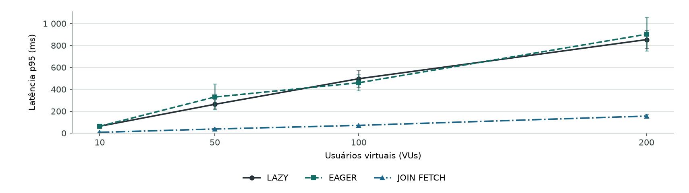
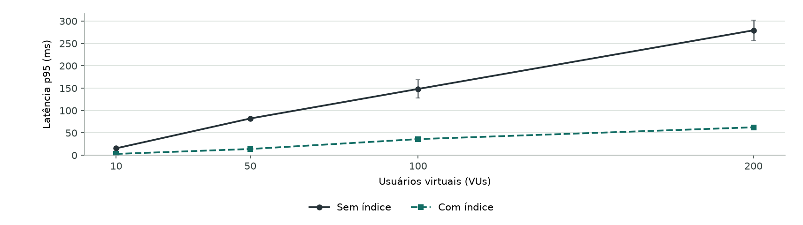

# Otimização de Web Services

Trabalho Prático A2 · Análise e Otimização de Sistemas · Universidade Veiga de Almeida

## 1. Introdução

A aplicação é uma API REST de catálogo e pedidos. O estudo mede o efeito do cache nos acessos ao banco, compara estratégias de persistência e avalia um índice para acelerar a busca de pedidos por cliente. Os resultados usam dados sintéticos e requisições HTTP locais.

[Consultar o painel](evidencias/painel.html) · [CSV das rodadas](evidencias/consolidado.csv) · [Reproduzir os experimentos](#8-reproduzir)

## 2. Arquitetura e tecnologias

O Spring Boot recebe as requisições. Hibernate/JPA consulta o PostgreSQL. As rotas com cache consultam o Redis antes de acessar o banco. O k6 mede a API pelo HTTP e as figuras são geradas do CSV com Matplotlib.

| Relação | Registros na execução |
|---|---:|
| Categoria · agrupa produtos | 20 |
| Produto · pertence a uma categoria | 10.000 |
| Cliente · possui pedidos | 5.000 |
| Pedido · vinculado a um cliente | 100.000 |
| Item de pedido · vincula pedido e produto | 300.000 |

O esquema define as chaves e a geração automática preenche as tabelas no primeiro início. Cada pedido tem 1 a 5 itens. O conjunto inclui clientes, datas, categorias e estados de pedido distintos. [Esquema](src/main/resources/schema.sql) · [Geração de dados](src/main/java/br/edu/uva/otimizacao/config/DataSeeder.java)

| Operação | Rota |
|---|---|
| Ler produto com ou sem cache | `GET /api/produtos/10/com-cache` ou `/sem-cache` |
| Alterar produto pelo HTTP | `PUT /api/produtos/10` com `{"preco":125.50}` |
| Ler agregação por categoria | `GET /api/categorias/11/estatisticas/com-cache` ou `/sem-cache` |
| Listar pedidos e comparar estratégias | `GET /api/pedidos/{lazy,eager,join-fetch,dto,dto-nativo}?limit=100` |
| Listar pedidos por cliente e verificar o plano | `GET /api/pedidos/cliente/150` e `/api/pedidos/cliente/150/explain` |

## 3. Cache

**Política.** Redis oferece armazenamento compartilhado e expiração por chave. Um hit retorna o JSON armazenado. Um miss busca o valor no PostgreSQL e o grava com TTL. O catálogo repete leituras dos mesmos produtos. Preço e estoque podem variar, então o TTL padrão é **60 s**. Visões analíticas podem repetir a agregação da mesma categoria. Essa consulta é mais custosa e tolera uma defasagem maior. Seu TTL é **300 s**. Esses valores são decisões de projeto para usos simulados. Uma entrada expira a partir da gravação.

```java
T valor = desserializar(json, tipo);
boolean hit = valor != null;
// No miss, consulta o banco e grava o resultado com TTL.
```

O `PUT` invalida a chave do produto e a agregação da categoria durante a transação. Um bloqueio de escrita dentro da instância aguarda leituras já em curso e impede novos preenchimentos até o commit. A expiração limita a vida das chaves restantes. Uma falha no Redis gera indisponibilidade nas operações dependentes dele e desfaz a atualização com invalidação. Com o Redis interrompido, o PUT respondeu HTTP 503 e o preço no banco permaneceu em R$ 20,54. O parâmetro `invalidarCache=false` existe para o experimento de desatualização. [Teste de rollback](evidencias/consultas/cache-rollback.json)

### Evidência da atualização e expiração

| Leitura | Estado | SQL | Serviço (ms) | Preço (R$) | TTL restante (s) |
| --- | --- | ---: | ---: | ---: | ---: |
| produto direto do banco | BYPASS | 1 | 1,919 | 8,70 | — |
| primeira consulta | MISS | 1 | 4,772 | 8,70 | 59 |
| repetição | HIT | 0 | 2,810 | 8,70 | 59 |
| categoria antes da atualização | MISS | 1 | 34,219 | 473,94 | 299 |
| após PUT com invalidação | MISS | 1 | 4,547 | 125,50 | 2 |
| repetição após PUT | HIT | 0 | 1,765 | 125,50 | 1 |
| categoria após PUT | MISS | 1 | 37,368 | 474,17 | 299 |
| PUT sem invalidação, leitura do cache | HIT | 0 | 1,298 | 125,50 | 1 |
| PUT sem invalidação, leitura do banco | BYPASS | 1 | 1,947 | 140,50 | — |
| leitura após expiração | MISS | 1 | 5,268 | 140,50 | 59 |

O preço anterior pode ser exibido depois de uma alteração proposital sem invalidação. Um cliente pode tomar uma decisão com preço ou estoque desatualizado. Os totais de categoria consideram pedidos pagos, enviados e entregues. O relatório usa preço médio em duas linhas da tabela para mostrar a invalidação da agregação. [Registro das requisições](evidencias/consultas/cache-roteiro.csv)

### Custo de hit e miss

Mediana de 15 leituras por alvo e estado, após aquecimento. O tempo de serviço inclui a consulta de TTL no Redis. A consulta de categoria agrega catálogo e itens de pedidos contabilizados.

| Alvo | Variante | SQL | Serviço (ms) | Cliente (ms) |
| --- | --- | ---: | ---: | ---: |
| Produto | Sem cache | 1 | 2,391 | 4,036 |
| Produto | Miss | 1 | 4,802 | 6,867 |
| Produto | Hit | 0 | 1,977 | 3,999 |
| Categoria | Sem cache | 1 | 36,445 | 40,388 |
| Categoria | Miss | 1 | 37,835 | 39,210 |
| Categoria | Hit | 0 | 1,620 | 3,249 |

A maior diferença ocorreu na agregação. O tempo de serviço mediano foi **36,445 ms** no PostgreSQL e **1,620 ms** no hit. Na busca por produto, o acesso direto levou **2,391 ms** e o miss levou **4,802 ms**. O miss faz a consulta ao banco e ainda envolve gravação no Redis. O benefício depende do custo da consulta, da reutilização e da expiração escolhida.

## 4. Consultas e índice

### LAZY, EAGER e consulta otimizada

Duas entidades da mesma tabela permitem mudar o carregamento de cliente e itens. A versão LAZY consulta os relacionamentos quando acessados. EAGER os carrega antecipadamente. Nesta listagem, o Hibernate emitiu consultas individuais para os clientes distintos e para os itens de cada pedido. O perfil `dev` exibe o SQL gerado e cada resposta registra os comandos interceptados no Hibernate.

```java
@ManyToOne(fetch = FetchType.LAZY)
@JoinColumn(name = "cliente_id")
private Cliente cliente;
```

A versão `JOIN FETCH` primeiro consulta os IDs da página e depois traz os pedidos, clientes e itens em uma única junção, evitando paginação de coleção em memória. O roteiro verificou que LAZY, EAGER e JOIN FETCH devolvem os mesmos dados. A versão sem itens mantém o cliente na resposta para evidenciar o custo de carregar a coleção sem usá-la.

| Estratégia | Pedidos | SQL | Itens no ORM | JSON (bytes) | Serviço (ms) | Cliente (ms) |
| --- | ---: | ---: | ---: | ---: | ---: | ---: |
| LAZY | 10 | 21 | 30 | 3.018 | 13,193 | 16,959 |
| EAGER | 10 | 21 | 30 | 3.018 | 12,933 | 15,749 |
| JOIN FETCH | 10 | 2 | 30 | 3.018 | 3,675 | 6,296 |
| LAZY sem itens | 10 | 11 | 0 | 1.341 | 6,731 | 9,919 |
| EAGER sem itens | 10 | 21 | 30 | 1.341 | 13,177 | 17,670 |
| DTO JPQL | 10 | 1 | 0 | 1.211 | 2,278 | 6,125 |
| DTO nativo | 10 | 1 | 0 | 1.211 | 3,323 | 6,556 |
| LAZY | 100 | 201 | 300 | 30.233 | 96,127 | 98,533 |
| EAGER | 100 | 201 | 300 | 30.233 | 99,203 | 101,441 |
| JOIN FETCH | 100 | 2 | 300 | 30.233 | 4,836 | 7,214 |
| LAZY sem itens | 100 | 101 | 0 | 13.490 | 48,613 | 50,601 |
| EAGER sem itens | 100 | 201 | 300 | 13.490 | 100,595 | 102,646 |
| DTO JPQL | 100 | 1 | 0 | 12.190 | 2,349 | 4,614 |
| DTO nativo | 100 | 1 | 0 | 12.190 | 2,767 | 4,894 |
| LAZY | 500 | 1.001 | 1.500 | 151.467 | 469,165 | 473,906 |
| EAGER | 500 | 1.001 | 1.500 | 151.467 | 493,428 | 499,040 |
| JOIN FETCH | 500 | 2 | 1.500 | 151.467 | 16,995 | 22,425 |
| LAZY sem itens | 500 | 501 | 0 | 67.877 | 253,535 | 257,056 |
| EAGER sem itens | 500 | 1.001 | 1.500 | 67.877 | 529,428 | 533,283 |
| DTO JPQL | 500 | 1 | 0 | 61.377 | 4,354 | 7,380 |
| DTO nativo | 500 | 1 | 0 | 61.377 | 4,550 | 8,039 |

Cada célula de tempo é a mediana de cinco leituras locais. O volume é o de itens inicializados no ORM e dos bytes do JSON compacto do campo `dados`. [Amostras individuais](evidencias/consultas/persistencia.csv) · [SQL observado](evidencias/consultas/sql-hibernate.txt)

Com 100 pedidos, LAZY e EAGER com itens fizeram **201 consultas** cada. A expansão repete buscas para cada pedido e cliente distinto, caracterizando N+1. Ao dispensar os itens, LAZY desceu para **101** consultas. EAGER manteve **201** e inicializou **300 itens** que a resposta dispensou. LAZY é adequado quando a relação só é usada em parte das operações. EAGER é defensável quando a relação é pequena, sempre usada e o SQL emitido é controlado. Para a listagem completa, o JOIN FETCH entregou o mesmo conteúdo em **2 consultas**.

**SQL nativo.** As duas projeções entregam o mesmo resumo com contagem de itens. Em JPQL, a limitação é aplicada à consulta agrupada. O SQL nativo limita os pedidos na subconsulta antes das junções. Com 500 pedidos, a mediana de serviço foi **4,354 ms** no JPQL e **4,550 ms** no SQL nativo, ambos com uma consulta. O JPQL teve a menor mediana nos três tamanhos avaliados. Essa comparação se refere às consultas testadas e à massa utilizada. JPQL usa entidades e tipos mapeados pelo ORM. O SQL nativo exige manter nomes de tabelas e colunas, particularidades do dialeto e conversões de tipos do resultado.

### Plano com e sem índice

A API e o plano usam a mesma projeção, filtro e ordem. O índice começa pelo filtro de igualdade e segue a ordem de data com desempate por ID.

```sql
SELECT id, data_pedido, status, valor_total
FROM pedido
WHERE cliente_id = 150
ORDER BY data_pedido DESC, id DESC;

CREATE INDEX idx_pedido_cliente_data
ON pedido (cliente_id, data_pedido DESC, id DESC);
```

Cada estado teve duas execuções de aquecimento e cinco `EXPLAIN (ANALYZE, BUFFERS)` registrados. As chaves primárias e o índice de itens por pedido foram mantidos nos dois estados. A listagem retornou o mesmo conteúdo.

| Observação | Sem índice | Com índice |
| --- | --- | --- |
| Acesso | Seq Scan | Bitmap Heap Scan + Bitmap Index Scan |
| Índice do experimento utilizado | Ausente | Sim |
| Ordenação no plano | Sim | Sim |
| Pedidos retornados | 20 | 20 |
| Linhas removidas pelo filtro | 99.980 | — |
| Buffers compartilhados no nó principal | hit=1650 | hit=23 |
| Mediana de execução (ms) | 3,859 | 0,082 |

O PostgreSQL usou o índice e manteve uma etapa de ordenação. O Bitmap Heap Scan agrupou os acessos às páginas da tabela e o Sort ordenou os 20 pedidos retornados. A mediana passou de **3,859 ms** para **0,082 ms**. O filtro encontra 20 pedidos entre 100 mil, cerca de **0,02%** da tabela. A seletividade e o estado dos buffers explicam por que a diferença é grande nesta consulta. O índice ocupou **3,89 MiB**.

O índice ocupa espaço e aumenta o trabalho de inserção, atualização e remoção de linhas. Sua seleção deve seguir os filtros, a ordenação, a seletividade e o plano real. Indexar indiscriminadamente acrescenta custo de manutenção para consultas que podem ser mais baratas por varredura. [Plano sem índice](evidencias/consultas/sem-indice.txt) · [Plano com índice](evidencias/consultas/com-indice.txt)

## 5. Testes de desempenho

O k6 foi escolhido por permitir carga parametrizada pelo número de usuários virtuais, coleta de percentis e reprodução pela linha de comando. O executor `constant-vus` manteve **10, 50, 100 e 200 VUs** por 12 s, com **duas repetições** para cada combinação. Cada VU inicia outra leitura após a anterior. VUs expressam concorrência e a vazão expressa requisições por segundo. [Executor do k6](https://grafana.com/docs/k6/latest/using-k6/scenarios/executors/constant-vus/)

- **Ambiente.** AMD Ryzen 5 5500, 6 núcleos e 12 CPUs lógicas, 23,9 GiB de RAM, Windows 10 Pro. Java 17.0.21.1 com heap de 256 MiB a 1 GiB, Spring Boot 3.3.5 e Hibernate 6.5.3. PostgreSQL 16.16 e Redis 7.4.12 no Docker Engine 29.6.1 com 11,6 GiB disponíveis à VM. O PostgreSQL usou 512 MiB de capacidade de memória compartilhada. Pool JDBC de 30 conexões. k6 1.5.0 no host. [Metadados](evidencias/execucao.json)
- **Controle.** Uma rodada por vez, com a mesma massa e o perfil `perf`. O aquecimento HTTP é feito antes da medição. O roteiro confirma o estado inicial do Redis e o resultado da operação de índice. A ordem das variantes foi invertida na segunda repetição. Só requisições da fase de medição entram nas métricas.
- **Métricas.** p95 e p99 são os tempos abaixo dos quais caíram aproximadamente 95% e 99% das requisições. A vazão divide as requisições pela janela medida, incluindo a conclusão das que ficaram em voo. A taxa de erro inclui respostas diferentes de 200, falhas de rede e cabeçalhos de cache fora do esperado. A tabela usa a mediana da métrica de cada rodada. p95 e p99 são percentis calculados por rodada antes dessa agregação. As barras nos gráficos de p95 mostram o menor e o maior valor observado.

A bateria válida tem **72 rodadas** e **3.055.712 requisições medidas**. [Rodadas individuais](evidencias/rodadas/) · [Resumo por combinação](evidencias/comparativo.csv)

### 5.1 Cache de agregações por categoria

As leituras percorrem as mesmas 20 categorias. Cache frio começa vazio e acumula hits na própria rodada. Cache quente começa preenchido com TTL de 600 s. TTL curto começa preenchido e vence em 2 s, permitindo observar novos misses. O k6 registra o estado pelo cabeçalho `X-Cache`. No gráfico de p95, o eixo vertical é logarítmico para distinguir as latências das quatro variantes.

| Variante | VUs | Média (ms) | p95 (ms) | p99 (ms) | req/s | Erros (%) | Hits (%) |
| --- | ---: | ---: | ---: | ---: | ---: | ---: | ---: |
| Sem cache | 10 | 96,47 | 153,28 | 197,88 | 103,9 | 0,000 | — |
| Sem cache | 50 | 501,45 | 758,12 | 911,66 | 98,7 | 0,000 | — |
| Sem cache | 100 | 888,32 | 1.189,09 | 1.642,28 | 109,7 | 0,000 | — |
| Sem cache | 200 | 1.692,25 | 2.023,11 | 2.760,86 | 111,9 | 0,031 | — |
| Cache frio | 10 | 1,80 | 2,50 | 3,50 | 5.096,7 | 0,000 | 99,96 |
| Cache frio | 50 | 5,14 | 8,50 | 12,31 | 9.169,6 | 0,000 | 99,93 |
| Cache frio | 100 | 8,23 | 12,37 | 19,90 | 11.424,3 | 0,000 | 99,90 |
| Cache frio | 200 | 19,44 | 31,80 | 55,42 | 9.681,4 | 0,014 | 99,80 |
| Cache quente | 10 | 1,97 | 3,00 | 4,00 | 4.660,7 | 0,000 | 100,00 |
| Cache quente | 50 | 4,50 | 7,39 | 10,00 | 10.379,6 | 0,000 | 100,00 |
| Cache quente | 100 | 7,14 | 11,23 | 16,70 | 13.078,9 | 0,000 | 100,00 |
| Cache quente | 200 | 14,27 | 24,51 | 42,75 | 13.039,4 | 0,011 | 100,00 |
| TTL curto | 10 | 2,41 | 3,27 | 6,12 | 3.877,1 | 0,000 | 99,58 |
| TTL curto | 50 | 10,74 | 11,46 | 302,30 | 4.491,1 | 0,000 | 98,70 |
| TTL curto | 100 | 25,52 | 17,60 | 884,35 | 3.758,2 | 0,000 | 97,83 |
| TTL curto | 200 | 65,68 | 34,70 | 1.883,97 | 2.853,7 | 0,001 | 96,81 |


### 5.2 Persistência com 30 pedidos e itens

| Variante | VUs | Média (ms) | p95 (ms) | p99 (ms) | req/s | Erros (%) |
| --- | ---: | ---: | ---: | ---: | ---: | ---: |
| LAZY | 10 | 50,90 | 63,10 | 73,60 | 195,6 | 0,000 |
| LAZY | 50 | 173,94 | 263,03 | 322,01 | 285,9 | 0,000 |
| LAZY | 100 | 345,78 | 496,44 | 582,47 | 286,6 | 0,000 |
| LAZY | 200 | 666,89 | 853,16 | 894,76 | 293,2 | 0,000 |
| EAGER | 10 | 50,42 | 63,04 | 83,95 | 197,8 | 0,000 |
| EAGER | 50 | 205,45 | 329,67 | 447,31 | 252,4 | 0,000 |
| EAGER | 100 | 346,56 | 459,59 | 496,02 | 287,5 | 0,000 |
| EAGER | 200 | 650,28 | 901,96 | 991,74 | 301,2 | 0,000 |
| JOIN FETCH | 10 | 5,31 | 7,74 | 10,58 | 1.823,1 | 0,000 |
| JOIN FETCH | 50 | 24,17 | 37,98 | 47,82 | 2.051,7 | 0,000 |
| JOIN FETCH | 100 | 44,63 | 71,09 | 90,90 | 2.225,0 | 0,000 |
| JOIN FETCH | 200 | 89,31 | 155,74 | 208,06 | 2.233,7 | 0,000 |



### 5.3 Busca de pedidos por cliente

Cada leitura consulta um dos 5.000 clientes, em sequência circular. A resposta tem os mesmos campos nas duas condições.

| Variante | VUs | Média (ms) | p95 (ms) | p99 (ms) | req/s | Erros (%) |
| --- | ---: | ---: | ---: | ---: | ---: | ---: |
| Sem índice | 10 | 10,73 | 15,50 | 20,00 | 917,4 | 0,000 |
| Sem índice | 50 | 54,40 | 82,24 | 101,86 | 915,3 | 0,000 |
| Sem índice | 100 | 102,71 | 148,22 | 198,10 | 972,8 | 0,000 |
| Sem índice | 200 | 199,29 | 279,32 | 393,47 | 990,9 | 0,000 |
| Com índice | 10 | 2,13 | 3,00 | 4,00 | 4.383,9 | 0,000 |
| Com índice | 50 | 8,99 | 14,01 | 19,80 | 5.408,9 | 0,000 |
| Com índice | 100 | 20,16 | 36,10 | 55,14 | 4.899,9 | 0,000 |
| Com índice | 200 | 35,15 | 62,50 | 88,19 | 5.636,3 | 0,000 |



## 6. Discussão

- **Ganhos.** A 100 VUs, o cache quente reduziu p95 de **1.189,09 para 11,23 ms**, o JOIN FETCH reduziu p95 de **496,44 para 71,09 ms**, o índice reduziu p95 de **148,22 para 36,10 ms**. O maior ganho relativo foi de **99,1%** com cache quente.
- **Carga e consistência.** As três alternativas mantiveram p95 menor em todos os níveis. A 200 VUs, o cache quente mediu **24,51 ms** contra **2.023,11 ms** da leitura direta. A menor rodada teve 1.147 requisições.
- **Cauda e TTL.** Com 100 VUs, TTL curto ficou em **25,52 ms** de média, **17,60 ms** de p95 e **884,35 ms** de p99. Foram **2.067 misses** e a taxa de hit foi **97,83%**. O cache frio mediu p99 de **19,90 ms** e o quente ficou em **16,70 ms**. Os estados iniciais e o TTL explicam a diferença de reutilização. As latências de hit e miss por rodada estão no CSV.
- **Gargalos e resultados abaixo do esperado.** O miss de produto teve mediana de **4,802 ms**, diante de **2,391 ms** sem cache. Na listagem, sair de **201 para 2 SQLs** reduz idas ao banco. O efeito também aparece a 100 VUs, com a vazão de **286,6 para 2.225,0 req/s** para páginas de 30 pedidos com itens. Na busca por cliente, a varredura sem índice consumiu mais buffers.
- **Falhas.** Um diagnóstico com 64 MiB de memória compartilhada registrou **39,68%** de erros na agregação sem cache a 100 VUs. O PostgreSQL informou falha ao reservar memória compartilhada. O ambiente da bateria comparativa usou **512 MiB** nos três cenários. A maior taxa de erro de uma rodada nessa bateria foi **0,061%**. [Diagnóstico](evidencias/diagnostico-memoria.json)

### Recursos e limites do estudo

Na amostragem complementar a 100 VUs, a coluna CPU expressa o percentual equivalente de um núcleo. Os blocos em cache do PostgreSQL são a diferença do contador coletado durante a amostra.

| Variante | CPU API (%) | Memória API | CPU PG (%) | Memória PG | CPU Redis (%) | Memória Redis | Blocos PG em cache |
| --- | ---: | --- | ---: | --- | ---: | --- | ---: |
| Sem cache | 15,2 | 559,3 MiB | 1.134,0 | 245MiB | 0,3 | 10.54MiB | 1.862.978 |
| Cache quente | 332,5 | 562,1 MiB | 14,3 | 177.6MiB | 21,2 | 10.91MiB | 24.335 |

A amostra sem cache concentrou CPU no PostgreSQL. Com cache quente, observou-se menos atividade no banco e mais CPU no processo da API. [Observações brutas](evidencias/recursos.json)

Os serviços e o gerador de carga dividiram o mesmo computador. Os resultados descrevem este ambiente, com dados sintéticos e predominância de leituras, e podem variar em máquinas diferentes. O Redis adiciona custo de rede, serialização e infraestrutura. Preenchimentos simultâneos da mesma chave podem elevar a latência no frio ou no vencimento. O bloqueio da atualização é local à instância. A alternativa com índice tem custo de manutenção em escrita e as consultas com relacionamentos precisam ser planejadas por caso de uso.

## 7. Conclusão

O cache evitou SQL no hit. Para a agregação, isso sustentou **13.078,9 req/s** a 100 VUs, frente a **109,7 req/s** sem cache. No acesso a pedidos, JOIN FETCH manteve a resposta completa e reduziu o N+1. Na busca por cliente, o PostgreSQL escolheu o índice composto e o p95 nessa carga caiu de **148,22 para 36,10 ms**. A escolha de cada intervenção depende do custo da consulta, do dado retornado e do uso sob carga.

## 8. Reproduzir

A API usa JDK 17 e Docker Compose. As medições usam Python 3.12 ou superior e k6 1.5.0 no PATH. Execute os comandos a seguir na raiz do repositório.

```powershell
docker compose up -d --wait
.\mvnw.cmd package
java -Xms256m -Xmx1g -jar target/a2-otimizacao-1.0.0.jar --spring.profiles.active=perf
```

No Linux ou macOS use `./mvnw package`. Aguarde a carga inicial de dados. O comando `curl.exe http://127.0.0.1:8080/api/admin/contagens` no Windows confirma a API e o volume. Use `curl` no Linux e macOS. O perfil `dev` pode ser usado para inspecionar o SQL fora da bateria. As portas locais são 8080 (API), 15432 (PostgreSQL) e 16379 (Redis). As variáveis `A2_API_PORT`, `A2_POSTGRES_PORT` e `A2_REDIS_PORT` permitem ajustá-las.

Execute o roteiro de medições em outro terminal e use um novo diretório de saída para cada bateria.

```powershell
python scripts/medir_consultas.py --saida resultados/consultas-nova
python scripts/rodar_carga.py --duracao 12 --repeticoes 2 --vus 10 50 100 200 --saida resultados/bateria-nova
python -m pip install -r requirements-graficos.txt
python scripts/gerar_graficos.py resultados/bateria-nova
```

Para conferir o roteiro de carga rapidamente, acrescente `--cenario indice --duracao 3 --repeticoes 1 --vus 2` ao comando de carga e use uma saída diferente. Se a porta da API for alterada, informe `--base-url` aos dois roteiros. Os gráficos e o painel são gravados na pasta da bateria. Abra `painel.html` no navegador. O HTML inclui os dados e as imagens da bateria para consulta e download offline. Para medir recursos, execute `docker stats` durante a carga e observe o processo Java no monitor de sistema.

Os scripts do índice também podem ser executados no PostgreSQL pelos arquivos [antes](sql/01_explain_antes_indice.sql), [criação](sql/02_criar_indice.sql), [depois](sql/03_explain_depois_indice.sql) e [limpeza](sql/04_limpar_indice.sql). O primeiro comando prepara o banco e mostra o plano sem o índice.

```powershell
docker compose exec -T postgres psql -U a2 -d a2db -f /sql/01_explain_antes_indice.sql
```

O experimento é local. Use `docker compose down` ao terminar. O volume preserva a massa para a próxima execução.

[Documentação do PostgreSQL sobre EXPLAIN](https://www.postgresql.org/docs/16/using-explain.html)
